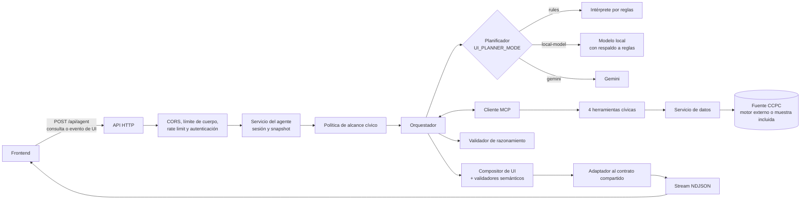
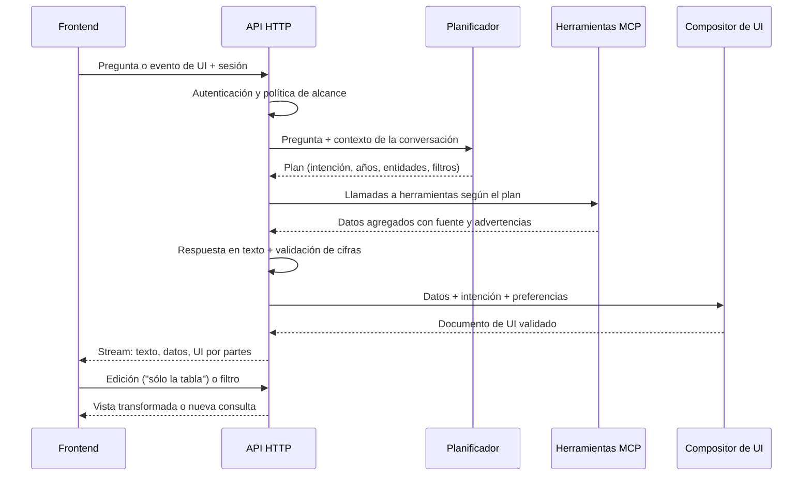

# Backend — Consulta ciudadana de datos electorales con interfaz generativa

Backend de un agente que responde preguntas en lenguaje natural sobre **participación electoral en México** (conteos censales de participación ciudadana, CCPC) y construye la interfaz para mostrarlas: indicadores, gráficas, tablas, filtros, notas metodológicas y la fuente de los datos.

La interfaz no sale de una lista de pantallas fijas. El agente entiende la pregunta, consulta herramientas MCP con datos agregados, valida las cifras y arma un documento declarativo de UI que el frontend renderiza. Las interacciones y ediciones posteriores ("deja sólo la tabla", elegir otra entidad en un filtro) regresan al mismo agente, que responde con una vista nueva o transformada.

## Qué hace

- **Entiende preguntas abiertas** sobre participación, abstención y lista nominal, con faltas de ortografía, gentilicios ("neoleoneses"), alias ("CDMX"), rangos de años, "la elección anterior" y preguntas de seguimiento dentro de la misma conversación.
- **Funciona sin conexión y sin claves de IA.** El planificador por defecto es determinista (por reglas). Gemini y un modelo local son opcionales.
- **Consulta datos sólo a través de MCP**, con cuatro herramientas cívicas validadas con Zod.
- **Valida lo que dice y lo que muestra**: no infiere causas, no inventa cifras, distingue porcentaje de puntos porcentuales, conserva la fuente y no mezcla el total nacional con entidades en una misma gráfica.
- **Elige la composición de la interfaz** según la intención y la forma de los datos (ranking, línea de tiempo, pirámide de edad y sexo, comparación de dos elecciones, metodología, evidencia, etc.).
- **Bloquea lo que está fuera de alcance**: recomendaciones de voto, predicciones de quién ganará, datos personales, intentos de cambiar sus instrucciones y temas que no son electorales.
- **Transmite la respuesta por partes** (stream NDJSON): progreso, texto, datos, interfaz y cambios incrementales.

## Arquitectura



### Flujo de una pregunta



## Planificador

El orquestador no depende de un proveedor concreto: recibe un `UiPlanner` y le pide, turno a turno, qué herramientas llamar o qué responder. El modo se elige con `UI_PLANNER_MODE`.

| Modo | Qué usa | Cuándo conviene |
|---|---|---|
| `rules` (por defecto) | Intérprete determinista en TypeScript | Demo sin internet ni claves; respuestas repetibles en milisegundos |
| `local-model` | Servidor compatible con OpenAI en el mismo equipo (por ejemplo Ollama) | Experimentos; si el modelo falla, tarda o inventa filtros, se usan las reglas |
| `gemini` | API de Google Gemini | Cuando hay clave y se quiere generación abierta |

El intérprete por reglas (`src/agent/planning/civic-query-interpreter.ts`) normaliza el texto y extrae:

- **años** (sólo los que tienen conteo: 2009, 2012, 2015, 2018, 2021 y 2024), rangos ("de 2009 a 2024", "desde 2012") y "la elección anterior";
- **entidades** por nombre, alias, gentilicio o clave INE;
- **sexo, grupos de edad y tipo de sección** (urbana, mixta, rural);
- **indicador**: participación, participación sobre lista nominal, abstención o lista nominal;
- **tipo de análisis**, con puntuación ponderada: resumen, comparación, tendencia, desglose, evidencia o metodología;
- **preferencias de presentación**: mapa, gráfica, tabla, ranking.

Si falta información, el año no tiene conteo o la pregunta no es electoral, el planificador pide una aclaración en lugar de adivinar. El plan resultante se valida con Zod.

El estado del planificador activo se informa en el encabezado `X-Ui-Planner` de `GET /api/system/status` (por ejemplo `rules; ready`).

### Evaluación del modelo local

`pnpm eval:planner` compara el modo `rules` contra el modelo local con 40 consultas: 34 del dominio electoral y 6 fuera de dominio. Mide intención, filtros correctos, filtros inventados, latencia, memoria y funcionamiento sin internet. El reporte se escribe en [`docs/evaluacion-modelo-local.md`](docs/evaluacion-modelo-local.md).

Con un modelo de 1.5 B parámetros el resultado fue: reglas 38/40 filtros correctos, 0 inventados y 4 ms (p95); modelo local 16/40 filtros correctos, 21 inventados y 1.1 s (p95). Por eso el modo por defecto es `rules`.

## Herramientas MCP

| Herramienta | Qué devuelve |
|---|---|
| `get_participation_summary` | Totales de un territorio y año: lista nominal, votaron, no votaron, no especificado, participación y abstención |
| `compare_elections` | El mismo territorio en dos o más elecciones, con la diferencia en puntos porcentuales |
| `get_participation_breakdown` | Desglose por entidad, sexo, grupo de edad o tipo de sección |
| `get_supporting_records` | Registros de evidencia que respaldan una cifra, con su fuente |

Además se exponen dos recursos: `civic://metric-definitions` (cómo se calcula cada indicador) y `civic://coverage` (qué años y dimensiones hay disponibles).

Cada herramienta valida entrada y salida con Zod, tiene timeout por consulta, límite de llamadas por minuto y devuelve errores recuperables (`retryable`) en lugar de fallar en silencio. El flujo es `tool → servicio → fuente de datos`. El agente nunca lee los datos directamente.

### Fuente de datos

La lógica de datos está detrás de una interfaz (`CivicDataSource`, en `src/application/ports/civic-data.ts`), así que se puede cambiar el origen sin tocar las herramientas:

- **Motor CCPC externo**: si `CCPC_DATA_DIR` apunta a la carpeta del módulo de datos, se carga dinámicamente (`src/infrastructure/ccpc/`).
- **Muestra incluida**: si `CCPC_DATA_DIR` está vacío, se usa una muestra CCPC empaquetada en `src/fixtures/`, y las respuestas lo indican con un aviso.

Indicadores oficiales: participación = votaron / (votaron + no votaron); abstención = no votaron / (votaron + no votaron). También se calculan la participación sobre lista nominal y el porcentaje no especificado.

## Validación de respuestas

**Texto** (`src/agent/reasoning/civic-reasoning-validator.ts`): se rechaza o se repara una respuesta que

- afirma causas ("bajó porque…") que los datos no permiten;
- menciona cifras, años o territorios que no vinieron de las herramientas;
- confunde porcentaje con puntos porcentuales;
- omite el numerador y el denominador cuando son necesarios;
- compara elecciones sin advertir cambios metodológicos o de lista nominal;
- habla de personas cuando los datos son agregados.

La fuente y el aviso de datos de muestra se agregan automáticamente. Si la respuesta no se puede reparar, se devuelve un error recuperable y no se manda interfaz.

**Interfaz** (`src/ui/generation/civic-semantic-ui-validator.ts` y `semantic-ui-validator.ts`): exige tabla o evidencia junto a las gráficas (salvo que el usuario pida "sin tabla" o "sólo la gráfica"), no mezcla el nivel nacional con entidades en una misma visualización y comprueba que títulos y textos hablen de los mismos territorios y años que los datos.

## Composición de la interfaz

`src/ui/generation/civic-ui-composer.ts` elige una de nueve composiciones según la intención y los campos que realmente traen los datos:

| Composición | Cuándo | Componentes principales |
|---|---|---|
| `ranking` | Comparar entidades | Barras ordenadas + tabla |
| `timeline` | Tres o más elecciones | Línea de tiempo + tabla |
| `age-sex` | Edad y sexo juntos | Pirámide (barras por sexo) + tabla |
| `two-elections` | Dos elecciones | Barras + indicador de diferencia + tabla |
| `group-comparison` | Sexo o tipo de sección | Barras + tabla |
| `summary` | Un territorio y un año | Indicadores + tabla |
| `evidence` | Registros de respaldo | Tabla de evidencia con fuente |
| `methodology` | Cómo se calcula algo | Texto metodológico y fuente |
| `insufficient-data` | No hay datos suficientes | Explicación para la ciudadanía, sin gráficas vacías |

Respeta preferencias como "sólo la tabla", "sin tabla" o "sólo la gráfica". Si se pide un mapa y el frontend aún no lo soporta, muestra un aviso y usa el ranking como alternativa. Cada documento se valida con Zod y con los validadores semánticos antes de enviarse. Si la composición falla, hay una interfaz de respaldo sin IA (`civic-ui-fallback.ts`).

La edición de una vista ya mostrada ("deja sólo la tabla", "muéstrame la fuente", "ordénala") se resuelve en `src/integration/ui-transformation.ts` sin volver a consultar los datos.

## Requisitos

- Git.
- Node.js **22 o superior**.
- Corepack y pnpm 10.34.5.
- Opcional: clave de Google Gemini (modo `gemini`), Ollama u otro servidor compatible (modo `local-model`), clave de ElevenLabs (voz) y un proyecto de Supabase (modo de autenticación `supabase`).

## Instalación

```bash
git clone -b Back-end <URL_DEL_REPOSITORIO>
cd <carpeta-del-repositorio>
corepack enable
corepack prepare pnpm@10.34.5 --activate
pnpm install --frozen-lockfile
cp .env.example .env
```

En Windows (PowerShell) el último paso es `copy .env.example .env`. Comprueba la instalación con `node --version` y `pnpm --version`.

## Variables de entorno

Todo parte de `.env.example`. Con los valores por defecto (`AUTH_MODE=local_sqlite` y `UI_PLANNER_MODE=rules`) el backend arranca sin ninguna clave externa.

| Variable | Uso |
|---|---|
| `AUTH_MODE` | `local_sqlite` (sesiones en un archivo SQLite local, sin servicios externos) o `supabase` |
| `AGENT_API_TOKEN` | Token de servicio que el frontend envía como `Bearer` en modo `local_sqlite` |
| `SQLITE_DATABASE_PATH` / `LOCAL_ACTOR_ID` | Archivo de sesiones e identificador del actor local |
| `SUPABASE_URL` / `SUPABASE_PUBLISHABLE_KEY` | Sólo en modo `supabase` |
| `CCPC_DATA_DIR` / `CCPC_DATASET_PATH` | Carpeta y archivo del motor de datos CCPC; vacío = muestra incluida |
| `UI_PLANNER_MODE` | `rules`, `local-model` o `gemini` |
| `LOCAL_MODEL_URL` / `LOCAL_MODEL_NAME` / `LOCAL_MODEL_TIMEOUT_MS` | Modelo local; la URL debe ser `localhost` o `127.0.0.1` |
| `GEMINI_API_KEY` / `GEMINI_MODEL` / `GEMINI_TIMEOUT_MS` | Sólo en modo `gemini` |
| `AGENT_API_HOST` / `AGENT_API_PORT` | Interfaz y puerto de la API (por defecto `127.0.0.1:3101`) |
| `AGENT_API_ALLOWED_ORIGINS` | Orígenes exactos del frontend, separados por comas; no acepta `*` |
| `AGENT_MAX_TOOL_CALLS` / `AGENT_TOOL_TIMEOUT_MS` / `AGENT_TOOL_MAX_RETRIES` | Límites del ciclo de herramientas |
| `AGENT_AUTH_RATE_LIMIT_PER_MINUTE` / `AGENT_API_RATE_LIMIT_PER_MINUTE` / `MCP_RATE_LIMIT_PER_MINUTE` | Límites de uso |
| `ELEVENLABS_API_KEY` y `ELEVENLABS_STT_*` | Transcripción de voz en tiempo real (opcional) |

`.env` nunca se sube al repositorio.

## Ejecución

### API para el frontend

```bash
pnpm api
```

La API queda en `http://127.0.0.1:3101`. Para comprobarla:

```bash
curl -i http://127.0.0.1:3101/api/system/status
```

En el frontend, la URL del agente es `http://127.0.0.1:3101/api/agent`.

### Servidor MCP por stdio

```bash
pnpm dev
```

Expone las herramientas MCP para un host compatible; no levanta la API web.

### Modelo local (opcional)

```bash
ollama pull qwen2.5:1.5b
```

En `.env`: `UI_PLANNER_MODE=local-model`, `LOCAL_MODEL_URL=http://127.0.0.1:11434` y `LOCAL_MODEL_NAME=qwen2.5:1.5b`. Para medirlo contra las reglas: `pnpm eval:planner` (agrega `-- --sin-internet` si la prueba se hace desconectado).

## Endpoints HTTP

| Método y ruta | Autenticación | Propósito |
|---|---:|---|
| `GET /api/system/status` | No | Salud y capacidades, sin exponer secretos; planificador activo en `X-Ui-Planner` |
| `POST /api/agent` | Sí | Pregunta, evento de UI o edición; responde con stream NDJSON |
| `POST /api/agent/snapshot` | Sí | Recupera la última vista segura de una sesión |
| `POST /api/transcription/realtime-session` | Sí | Crea una sesión efímera de transcripción de voz |

El cuerpo máximo es 16 KiB. El stream de `/api/agent` lleva eventos de progreso, texto, resultados de herramientas, registros de datos, la interfaz (primero la raíz y luego cada bloque), cambios incrementales, estado, errores y cierre. Cada vista lleva número de revisión para descartar cambios obsoletos.

Los porcentajes viajan al frontend como fracción (0.6122 = 61.22 %). El contrato compartido con el frontend vive en `packages/contracts/` y tiene una huella (fingerprint) que ambos lados deben compartir.

## Seguridad

- CORS sólo con orígenes explícitos; límite de tamaño de cuerpo.
- Rate limits separados para autenticación, operaciones costosas y herramientas MCP.
- Política de alcance antes del planificador: bloquea recomendaciones de voto, predicciones, datos personales (CURP, clave de elector, domicilio), intentos de cambiar las instrucciones y temas ajenos.
- Sólo datos públicos agregados; nada identifica a una persona.
- La interfaz es una DSL tipada validada con Zod: no se ejecuta HTML ni JavaScript generado.
- Timeouts, reintentos acotados y número máximo de herramientas por turno evitan ciclos.
- Si falta el modelo o la voz, la API responde con un estado controlado y nunca inventa datos.

## Pruebas

```bash
pnpm typecheck
pnpm test           # todas las pruebas
pnpm test:civic     # sólo planificador, herramientas, validadores y composición
pnpm build
pnpm security:audit
```

Estado actual: 134 pruebas (133 pasan y 1 se omite si no está configurado `CCPC_DATA_DIR`, porque usa el motor de datos real). Cubren, entre otras cosas:

- paráfrasis que deben producir exactamente el mismo plan;
- que el planificador no invente años, territorios ni filtros;
- aclaraciones y herencia de filtros en conversación;
- cada herramienta MCP por separado y en conjunto;
- las reglas del validador de razonamiento y de interfaz;
- las nueve composiciones, validadas contra el contrato compartido;
- el respaldo del modelo local cuando falla o inventa;
- que el sistema arranque sin Gemini.

## Estructura

```text
src/http/                    API HTTP: endpoints, CORS, límites y estado del sistema
src/agent/orchestrator.ts    ciclo pregunta → plan → herramientas → respuesta → UI
src/agent/planning/          planificadores (reglas, modelo local, Gemini) y plan cívico
src/agent/security/          política de alcance cívico
src/agent/reasoning/         preparación de datos y validador de razonamiento
src/agent/mcp-client/        cliente MCP y validación de salidas
src/agent/prompts/           instrucciones para el modo Gemini
src/agent/stream/            eventos del stream NDJSON
src/server.ts                servidor MCP: registra herramientas y recursos
src/tools/                   las cuatro herramientas cívicas
src/services/                servicio de datos cívicos (timeouts, cálculo de indicadores)
src/application/ports/       interfaz de la fuente de datos
src/infrastructure/ccpc/     adaptador al motor de datos CCPC
src/fixtures/                muestra CCPC incluida
src/resources/               recursos MCP (definiciones y cobertura)
src/domain/                  catálogo de entidades con su clave INE
src/ui/                      DSL de interfaz, composición, validadores y respaldo
src/integration/             sesiones, snapshots, adaptador al contrato y ediciones de vista
src/repositories/            sesiones en SQLite o Supabase
src/transcription/           voz en tiempo real
packages/contracts/          contrato compartido con el frontend
scripts/planner-evaluation/  evaluación del planificador (40 consultas)
tests/                       pruebas automatizadas
```

## Decisiones y trade-offs

- **Reglas por defecto en lugar de un modelo:** cubren menos variedad de lenguaje que un modelo grande, pero son repetibles, explicables, instantáneas, funcionan sin internet y nunca inventan filtros.
- **Planificador intercambiable:** el orquestador no sabe qué proveedor hay detrás, así que cambiar de reglas a Gemini o a un modelo local es configuración, no código.
- **MCP entre el agente y los datos:** añade una capa, pero las herramientas quedan tipadas, auditables y reemplazables.
- **Fuente de datos detrás de una interfaz:** se puede pasar de la muestra al motor CCPC completo sin tocar herramientas ni agente.
- **DSL validada en lugar de código generado:** limita la libertad de diseño, pero evita ejecutar código arbitrario y permite validar la interfaz antes de mostrarla.
- **Validar texto e interfaz por separado:** cuesta reintentos, pero evita que una cifra mal dicha o una gráfica engañosa llegue a la ciudadanía.
- **Stream NDJSON:** la respuesta se percibe más rápido y habilita cambios incrementales, a cambio de manejar revisiones.
